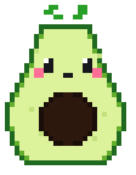

# 🥑🐾 Pixel Mascot Pomodoro

<p align="center">
  
</p>

<p align="center">
  <b>Et herlig, flytende skrivebords-kjæledyr og Pomodoro-timer bygget i Python! ⏱️🎉</b><br>
  <i>A cute, floating desktop mascot and Pomodoro timer built in Python!</i><br>
  <i>¡Una adorable mascota de escritorio y temporizador Pomodoro en Python!</i><br><br>
  Laget av <b><a href="https://github.com/OneUp82">OneUp82</a></b>
</p>

---

## 🌟 Funksjoner / Features / Características

### 1. 🌐 3 Språk / 3 Languages / 3 Idiomas
Maskoten støtter dynamisk bytte mellom 3 språk via høyreklikk-menyen:
- 🇳🇴 **Norsk** (Bokmål)
- 🇬🇧 **English**
- 🇪🇸 **Español**

Alle menyer, skinnnavn, knapper og innstillingsdialoger oppdateres umiddelbart!

---

### 2. 🥑 10 Søte Skins / 10 Cute Skins
Bytt når som helst mellom 10 unike pixel art-figurer:
1. 🥑 **Avokado / Avocado / Aguacate**
2. 🐱 **Katt / Cat / Gato**
3. 🐶 **Hund / Dog / Perro**
4. 🐸 **Frosk / Frog / Rana**
5. 🦆 **And / Duck / Pato**
6. 🐼 **Panda**
7. 🤖 **Robot**
8. 👻 **Spøkelse / Ghost / Fantasma**
9. 🍓 **Jordbær / Strawberry / Fresa**
10. 🐻 **Bjørn / Bear / Oso**

---

### 3. 🔊 Tilpasset Lyd / Custom Sounds
Hvert skin har sin egen unike, syntetiserte lydeffekt:
- Katten mjauer, hunden bjeffer, avokadoen popper, roboten piper 8-bit, osv.!

---

### 4. 📳 Risteeffekt / Screen Shake Animation
Når tiden når `00:00:00`, rister og danser maskoten fysisk på skjermen med dempet oscillasjon!

---

### 5. 📏 4 Skalerbare Størrelser / 4 Scalable Sizes
Pikslene forblir knivskarpe (Nearest Neighbor-skalering):
- ▫️ **Liten / Small** (224 x 288 px)
- ◽ **Medium** (280 x 360 px) – *Standard*
- ◻️ **Stor / Large** (336 x 432 px)
- ⬛ **Ekstra Stor / Extra Large** (392 x 504 px)

---

### 6. 🖱️ Interaktiv & Rammeløs / Frameless & Draggable
- Hold nede **venstre museknapp** for å dra maskoten hvor som helst på skjermen.
- Klikk direkte på magen for å starte eller pause!
- Høyreklikk for full tilgang til menyer og innstillinger.

---

## 🚀 Slik starter dere appen / How to run

### 1. Installer avhengigheter / Install dependencies:
```powershell
pip install -r requirements.txt
```

### 2. Start maskoten / Launch:
```powershell
python pomodoro_cat.py
```

---

## 👨‍💻 For Utviklere / For Developers

Prosjektet er strukturert for å være enkelt å lese, vedlikeholde og utvide for andre utviklere:
- **Internasjonalisering (i18n):** All tekst er samlet i `TRANSLATIONS`-ordboken i `pomodoro_cat.py`. For å legge til et nytt språk (f.eks. tysk eller fransk), legg bare til språkkoden i `LANGUAGES` og oversett strengene i `TRANSLATIONS`.
- **Nye Skins:** Lagre et 28x36 (eller skalert) bilde i `skins/{id}.png` og en lyd i `skins/{id}.wav`, og legg til definisjonen i `SKIN_DEFINITIONS`.
- **Rammeløs rendering:** Bruker `-transparentcolor` i Tkinter for pikselperfekt gjennomsiktighet på Windows.

Les mer om arkitekturen i kildekoden til [`pomodoro_cat.py`](pomodoro_cat.py) og [`ABOUT.md`](ABOUT.md).

---

## 📜 Lisens
Åpen kildekode under **MIT License**. Laget av **[OneUp82](https://github.com/OneUp82)**.
