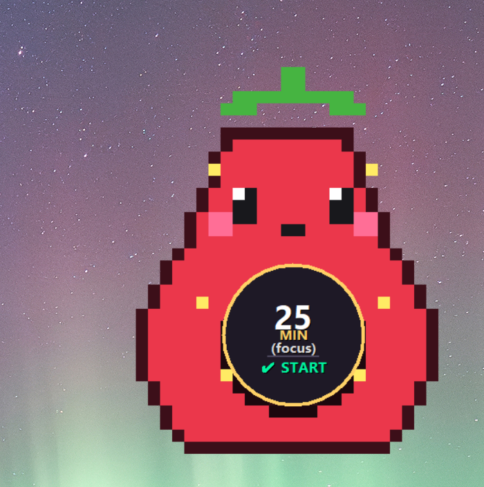

<p align="center">
  
</p>

<h1 align="center">🥑 Pixel Mascot Pomodoro</h1>

<p align="center">
  <b>A charming, borderless floating desktop mascot and Pomodoro timer built in Python.</b><br>
  Keep your focus sharp with an adorable pixel-art companion that lives right on your screen.
</p>

<p align="center">
  
  
  
  
  
</p>

---

## ✨ Why You'll Love It

- 🪟 **True Frameless Companion** — No clumsy window borders or title bars. The mascot floats naturally above your apps and wallpapers.
- 🖱️ **Fully Draggable** — Click and drag the mascot anywhere on your desktop.
- 🎭 **10 Handcrafted Pixel-Art Skins** — Switch instantly between Avocado, Cat, Dog, Frog, Duck, Panda, Robot, Ghost, Strawberry, and Bear.
- 🔊 **Unique Voice for Every Skin** — Every mascot has its own synthesized audio cue: kitten meows, playful barks, retro 8-bit chimes, cartoon pops, and crystal bells.
- 📳 **Celebratory Screen-Shake** — When your countdown reaches zero, the mascot vibrates with an energetic screen-shake animation to celebrate your victory!
- 🌐 **Trilingual Out-of-the-Box** — Switch seamlessly between **English**, **Norwegian**, and **Spanish** in real-time.
- 📏 **Razor-Sharp Scaling** — Choose between **Small**, **Medium**, **Large**, and **Extra Large** with authentic nearest-neighbor pixel preservation.
- ⚡ **Lightweight & Fast** — Built with native Tkinter and Pillow. Zero heavy Electron bloat, near-instant launch, and ultra-low memory usage.

---

## 📸 In Action

> The mascot's belly houses a high-contrast smart display with a circular progress ring, remaining time, custom task name, and one-click controls.

<p align="center">
  
</p>

---

## 🎮 How to Interact

| Action | What It Does |
|---|---|
| **Left-Click + Drag** | Move your mascot anywhere on your screen. |
| **Left-Click on Belly** | Toggle **Start** / **Pause** instantly. |
| **Right-Click** | Opens the complete context menu (Skins, Sizes, Language, Presets, Settings, Sound Test, Screen-Shake, Always-on-Top, Reset, About, Quit). |

---

## 🚀 Quick Start (Running in 30 Seconds)

### 1. Clone the repository
```bash
git clone https://github.com/OneUp82/pomodoro.git
cd pomodoro
```

### 2. Install dependencies
```bash
pip install -r requirements.txt
```

### 3. Launch your mascot!
```bash
python pomodoro_cat.py
```

---

## 🎨 Available Skins & Soundscapes

| Mascot | Name (EN) | Sound Profile |
|:---:|:---|:---|
| 🥑 | **Avocado** *(Avo-friend)* | Bubbly cartoon pop & squish |
| 🐱 | **Cat** *(Kitty)* | Gentle melodic kitten meow |
| 🐶 | **Dog** *(Puppy)* | Cheerful double puppy bark |
| 🐸 | **Frog** *(Ribbit)* | Resonant swamp croak |
| 🦆 | **Duck** *(Quack)* | Classic nasal duck quack |
| 🐼 | **Panda** *(Bamboo)* | Crispy bamboo munch chime |
| 🤖 | **Robot** *(Beep)* | Retro 8-bit arcade arpeggio |
| 👻 | **Ghost** *(Boo)* | Ethereal vibrato whistle |
| 🍓 | **Strawberry** *(Berry)* | Sweet crystal bell chime |
| 🐻 | **Bear** *(Teddy)* | Warm cozy bear hum & harp |

---

## 🛠️ Architecture & Extensibility

The codebase is built with clean separation of concerns and thorough docstrings, making it enjoyable to explore and modify.

### 🌐 Adding a New Language
All localized strings reside in the `TRANSLATIONS` dictionary inside `pomodoro_cat.py`. Adding a new language takes just a few lines:
```python
# 1. Register the language code and display label
LANGUAGES["de"] = "🇩🇪 Deutsch"

# 2. Add translation entries in TRANSLATIONS
TRANSLATIONS["de"] = {
    "menu_skin": "🎨 Skin wechseln...",
    "btn_start": "✔ STARTEN",
    # ...
}
```

### 🎨 Creating a Custom Skin
1. Place your 28×36 (or scaled) pixel-art PNG into `skins/<your_skin_name>.png`.
2. Place a matching sound effect into `skins/<your_skin_name>.wav`.
3. Register it in `SKIN_DEFINITIONS`:
```python
SKIN_DEFINITIONS.append({
    "id": "dragon",
    "names": {
        "en": "🐉 Dragon",
        "no": "🐉 Drage",
        "es": "🐉 Dragón"
    }
})
```

---

## 📋 Requirements

- **Python:** 3.10 or newer
- **customtkinter:** Modern styling utilities
- **Pillow (PIL):** Pixel-perfect image processing
- **pygame:** Audio playback engine *(with Windows `winsound` as an automatic fallback)*

---

## 👤 Author

Crafted by **[OneUp82](https://github.com/OneUp82)**.

---

## 📄 License

This project is licensed under the [MIT License](LICENSE) — feel free to use, modify, and build upon it!
